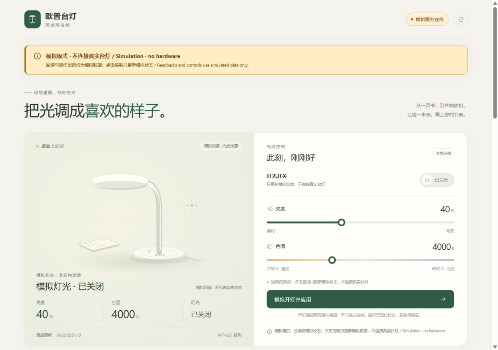

# OPPLE MT428 Local · 欧普台灯局域网控制

[简体中文](README.zh-CN.md) · [Protocol research](docs/research.en.md) · [中文研究笔记](docs/research.zh-CN.md)

Local UDP discovery, control tools, a browser demo, and reproducible research notes for the **OPPLE MT428-D0.5×36+0.2×21-WTT** Huawei HiLink desk lamp. The tested unit exposes both legacy HiLink traffic and the older OPPLE UDP interface; the latter provides a practical local control path without a cloud account token.

This project collects the details that were missing from a generic “OPPLE supported” claim: model identity, discovery without the old SKU filter, strict reply validation, an off-state dimming quirk, and a newly located **independent arm/background-light protocol**.

**Status: alpha.** Power, legacy brightness, and color-temperature commands were tested on one physical SKU `0x50061` unit. **Independent side-light writes have not been hardware-tested.** They are disabled by default and isolated behind explicit experimental/write flags. Do not interpret a candidate state field or a successful simulator run as physical verification.

Independent community research; not affiliated with, endorsed by, or sponsored by OPPLE, Huawei, Broadlink, or Home Assistant. No vendor APK, decompiled code, firmware, SDK, logo, credentials, or raw network captures are included.



## Start without a lamp

Python **3.10+**. There are no third-party runtime dependencies. From the repository root:

```sh
python -m opple_mt428 serve --simulate
```

Open **http://127.0.0.1:8765/**. The page is clearly labeled as simulation; it creates no device UDP socket. The demo includes a light illustration, power, brightness, color temperature, local scenes, an in-process off timer, initial-state restore, capability notes, and an integration/multicast explainer.

To preview the experimental panel without hardware:

```sh
python -m opple_mt428 serve --simulate --experimental-side-light
```

The static UI is currently Chinese, with bilingual operating-mode and experimental notices. Documentation and contribution guidance are available in English and Chinese.

## Find the lamp on your LAN

Discovery sends **one read-only SEARCH** to UDP **55001**, then collects replies. It does not turn on the light, change brightness, pair, reset, or scan every address in a subnet.

1. Keep the lamp's existing 2.4 GHz Wi-Fi provisioning. Connect your computer to a reachable LAN; allow local UDP replies through your host firewall.
2. Find your computer's actual IPv4 address and prefix: Windows `ipconfig` / `Get-NetIPAddress`, Linux `ip -4 address`, or macOS Network settings. Router DHCP leases are also useful. A `Broadlink-*` hostname is a clue, not a universal protocol guarantee.
3. Choose the correct interface explicitly, especially with VPNs or multiple adapters. Replace the documentation-only address below with **your computer's local address/prefix**, not the lamp address.

```sh
python -m opple_mt428 discover --interface 192.0.2.10/24 --json
```

If you already know the lamp IP, use one unicast discovery instead:

```sh
python -m opple_mt428 discover --target 192.0.2.42 --json
```

`192.0.2.0/24` is TEST-NET example space, not your real network. The output contains your local device IP/MAC/name; redact it before sharing.

Discovery checks message type, serial, lengths, CRC, source endpoint, and the reported address. It returns all valid candidates rather than accepting only legacy SKU `0x100010e`; the tested desk lamp is **`0x50061`**. Unknown SKUs are listed but not automatically controllable. Select the lamp explicitly and compare its MAC with the router/device label. UDP/XOR is not cryptographic authentication.

For troubleshooting and detailed steps, see [discovery guide](docs/discovery.md).

## Inspect without changing light

Replace both placeholders using your own discovery result:

```sh
python -m opple_mt428 status --ip 192.0.2.42 --mac 02:00:00:00:00:01
python -m opple_mt428 serve --ip 192.0.2.42 --mac 02:00:00:00:00:01
```

Hardware web mode is **read-only by default**. GET status sends SEARCH/QUERY only. All light changes and scheduled off actions are blocked on the server and transport sides. The web server binds **127.0.0.1** only.

When you intentionally want real light control:

```sh
python -m opple_mt428 serve --ip 192.0.2.42 --mac 02:00:00:00:00:01 --allow-write
```

**Light-change warning:** on the tested firmware, dimming while off is ignored. Applying brightness/color temperature may briefly power on the lamp to set parameters before restoring its off state. “Power on and apply” leaves it on. Do not enable writes during a quiet/nighttime investigation.

## Side light: the useful new lead

Static analysis of the vendor-distributed **OPPLE Smart Lighting / 欧普智慧灯光** Android app links **SKU `0x50061` → `WifiDesklamp_0061`**, with dedicated arm-control UI methods and a local UDP command **`0x03450000`**. It provides separate arm power/brightness and head power/brightness/CCT fields. Candidate QUERY body offsets are **52–57**.

Evidence includes the official distribution link, package/version, SHA-256, relevant classes/methods, and field tables in the [research notes](docs/research.en.md#side-light-static-analysis). Vendor code/assets are not redistributed. This is stronger than guessing a command from the product name, but **current-firmware placeholder behavior, physical channel mapping, and collateral effects still need daylight verification**.

A later [read-only observation](docs/observations.md) found candidate head fields consistent with the legacy state in one snapshot; this still does not validate independent arm writes or placeholder semantics.

To inspect candidate read-only fields:

```sh
python -m opple_mt428 status --ip 192.0.2.42 --mac 02:00:00:00:00:01 --experimental-side-light
```

Experimental side-light writes require **both** `--allow-write` and `--experimental-side-light`. The panel sends a single request, reports only candidate readback matching, and never upgrades it to “hardware verified.” No command enumeration or unknown-field brute force is implemented.

## Capabilities and limits

| Feature | Evidence / implementation |
| --- | --- |
| Read-only discovery and legacy status | Physical unit tested; replies validated |
| Power, raw brightness `0..255`, CCT `2700..6500 K` | Writes/readback tested on one unit; no physical photometry |
| Independent side/arm light | Vendor-app static evidence; experimental adapter, not hardware-tested |
| Local scenes | Combinations of known values, not vendor-native modes |
| Local off timer / restore | Process-owned; computer sleep/exit/restart can cancel or delay execution |
| Vendor reading/writing/computer/favorite modes | Documented; full native protocol unimplemented |
| Vendor device-stored schedule/countdown, Pomodoro, button indicator | Documented or reported; unimplemented |
| Cloud-free first-time Wi-Fi provisioning | Not established; preserve an already provisioned device |
| Firmware/model variants | Not generally supported; matching MT428 prefix alone is insufficient |

Brightness percent is a linear display of raw values; it is not proven to match the official app's scale. The version word is a raw field, not a decoded firmware version. Current MAC-derived XOR is an observed encoding, not secure encryption.

## HTTP and integration

The demo API includes `GET /api/status`, `POST /api/control`, `/api/scene`, `/api/timer`, `/api/restore`, and the gated `/api/experimental/side-light`. See [API reference](docs/api.md).

The planned architecture is a single always-on LAN adapter → HTTP → router UI / ESP management page / MCP tools. Multicast observed at **`238.238.238.238:5683`** is a discovery group, not the lamp's address; the working control path uses unicast UDP55001 and does not require extending multicast across networks. See [architecture](docs/architecture.en.md).

This is **not** a Home Assistant custom component or a general Huawei router/4G-modem HiLink API library. Home Assistant's built-in [Opple integration](https://www.home-assistant.io/integrations/opple/) is a useful existing option; this repository records additional MT428-specific findings.

## Research, sources, and credit

- [Research / protocol / evidence ledger](docs/research.en.md) · [中文](docs/research.zh-CN.md)
- [Router, ESP, MCP architecture](docs/architecture.en.md) · [中文](docs/architecture.zh-CN.md)
- [Source index and related projects](docs/sources.md)
- [Third-party notices and license provenance](THIRD_PARTY_NOTICES.md)
- [Contributing](CONTRIBUTING.md) · [Security and privacy](SECURITY.md)

The original **jedmeng/python-oppleio** work made this investigation practical. Its legacy fork and Home Assistant's integration provided further context. Upstream license-file/metadata discrepancies are documented rather than flattened into a misleading MIT claim.

## Tests

Tests use synthetic packets, fake transports, an in-memory lamp, and loopback HTTP. **No hardware access or real lamp writes are required.**

```sh
python -m unittest discover -s tests -v
node --check opple_mt428/static/app.js
```

Optional installation: `python -m pip install .`; then use `opple-mt428` instead of `python -m opple_mt428`.

## License

**Apache-2.0**; see [LICENSE](LICENSE), [NOTICE](NOTICE), and [THIRD_PARTY_NOTICES.md](THIRD_PARTY_NOTICES.md). Research tables describe independently summarized protocol observations. Linked proprietary material remains subject to its owners' rights and is not covered by this project's license.

Search terms: OPPLE / 欧普 / 欧普智慧灯光, MT428, MT428-D0.5×36+0.2×21-WTT, Huawei HiLink / 华为智选 / 智慧生活, Broadlink, LAN control, UDP 55001, SKU 0x50061, arm light / side light / background light / 灯臂 / 侧灯 / 背景光, CoAP multicast, Home Assistant, ESP32, MCP.
