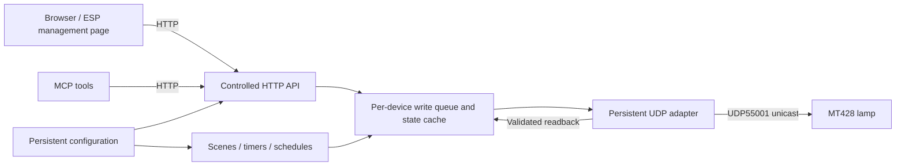

# Opple MT428 local adapter architecture

[简体中文](architecture.zh-CN.md) · [Research and evidence](research.en.md)

Target: **MT428-D0.5×36+0.2×21-WTT**, tested SKU `0x50061`, raw version field `0x210`. This document defines a general deployment architecture and future interface contracts. It does not represent completed persistent router deployment, ESP page integration, or MCP acceptance. The research document defines tested capabilities and sources. Preparing these documents did not involve connecting to the lamp or sending packets.

The example lamp `192.0.2.42` is a TEST-NET-1 documentation address; `02:00:00:00:00:01` is a synthetic, locally administered unicast MAC. Replace both with the authorized device's actual configuration before deployment. No user-specific private topology, real device identifiers, or account material is included.

## 1. One protocol adapter, multiple management clients

Run a lightweight UDP adapter persistently on a router or an always-on host near the device, exposing an HTTP service. The ESP management page, ordinary browsers, and MCP call the same service. Scenes, timers, and schedules also use its execution queue. ESP is not a mandatory relay for lamp UDP traffic; taking ESP offline should not interrupt control or schedules already owned by the router service.



“Single writer” means one execution owner for all writes to a lamp, not one permitted management page. Concurrent HTTP handling, background polling, retries, restore, and schedules must not create competing controllers. The official App and physical keys remain external sources of change. An internal write queue cannot prevent those operations; readback must detect changed state.

OpenWrt-style systems can use procd; other systems can use their native process supervisors. A lightweight Lua runtime or small executable is suitable if it provides UDP, validation algorithms, locking, and timing. Do not start an independent polling process for each HTTP request. Implementation and README documentation should choose the language, packaging, and startup commands without assuming a particular user's router resources or filesystem layout.

## 2. Identity, configuration, and migration

External clients use a fixed logical `deviceId`, such as `opple_mt428_01`. It is separate from the DHCP address, adapter host, and protocol device identifier returned by discovery. Automation continues to reference the same logical ID when the lamp changes networks.

| Configuration / state | Stability and purpose |
| --- | --- |
| `deviceId` | Logical identity within the service namespace. Preserve it during migration rather than naming tools or scenes after an IP address. |
| Lamp IP address | Migratable connection configuration. An operator can reserve a DHCP address or update it explicitly; the old address must not be assumed permanent. |
| Expected MAC | Identity check in restricted local configuration. Do not place real values in public logs or API examples. MAC matching is not cryptographic authentication. |
| Protocol device identifier, serials, receive port | Adapter runtime state, obtained again through discovery; distinct from logical `deviceId`. |
| SKU and raw version | Select a validated protocol profile and record compatibility boundaries. Start read-only on a mismatch or new version rather than expanding support automatically. |
| HTTP listener, Host / Origin, private-network policy | Separate access configuration, not inferred automatically from the lamp IP and not part of device identity. |
| Scene / schedule IDs and configuration revision | Service-owned persistent definitions shared by the management page and MCP. |

This JSON illustrates configuration concepts; it is **not a promised configuration-file schema**:

```json
{
  "deviceId": "opple_mt428_01",
  "lampIp": "192.0.2.42",
  "expectedMac": "02:00:00:00:00:01",
  "udpPort": 55001,
  "mode": "read-only",
  "privateNetwork": { "enabled": false },
  "timeZone": "Asia/Shanghai"
}
```

For migration, retain `deviceId` and scene / schedule IDs, connect to the destination's 2.4 GHz network through the official procedure, and update the IP, expected identity, and HTTP / private-network access configuration. Begin with read-only discovery and readback; the operator separately authorizes writable testing. Resume schedules only after checking timezone, clock synchronization, and execution ownership. Do not reset, unbind, or change firmware merely to migrate. Fully offline provisioning after factory reset remains untested.

Cross-network management uses authenticated access or a private channel to the local HTTP service. The verified UDP55001 path does not depend on `238.238.238.238:5683` multicast, so that multicast group need not be extended to remote clients. Unicast requests and replies must still be reachable.

## 3. Single write queue, event IDs, and readback

Maintain one execution worker per device. Each entry point validates identity, authorization, mode, capabilities, and parameters before submitting work. Combined controls, temporary power-on, readback, and restoration to off form one queue job that other service operations cannot interleave with. Locking only individual UDP `send` operations is insufficient. Process ownership or locking should also prevent two real-device writer instances from running simultaneously.

Suggested execution sequence:

1. Allocate or accept an `eventId`, check the idempotency key, device, and configuration revision, and mark the job `accepted`.
2. Obtain fresh state and verify identity; cached state alone does not establish the current power state.
3. Calculate the complete sequence and illumination risk. Reject it, execute directly, or permit temporary power-on according to policy. Do not guess unknown fields.
4. Send permitted absolute-value commands serially. Filter replies by message type, source, length, serial, and CRC; actively QUERY after writes.
5. Compare requested values with actual readback. A protocol profile must specify any numeric tolerance and return both requested and reported values; do not silently clamp and claim an exact match.
6. If restoration to off is required, record its result as a distinct step. Finish the event with its outcome and latest trustworthy state.

An `eventId` identifies a management operation and is separate from the UDP request serial. An HTTP retry with the same idempotency key returns the existing event or its state rather than executing again. Reusing a key with different parameters should be rejected. Deduplication needs bounded retention. Schedules requiring deduplication across restarts cannot depend on memory alone. Use explicit `power=true/false`, avoiding toggle semantics that reverse state when a request is repeated.

| Outcome | Meaning for clients |
| --- | --- |
| `accepted` / `queued` | The service accepted the operation; lamp execution is not established. |
| `sent` / `verifying` | A command was sent and readback is pending; this is not success confirmation. |
| `verified` | The relevant fields passed valid, fresh readback. This does not establish illuminance, physical color temperature, or side-light effects. |
| `partial` / `failed` | Some steps did not reach their targets. Return per-field results and the result of restoration to off. |
| `unknown` | Packet loss or failed readback leaves the final effect uncertain. Do not equate this with either “not executed” or success. |
| `rejected` | Parameters, mode, capability, identity, or risk policy disallowed the request. No control packet was sent for it. |

UDP cannot provide an exactly-once guarantee across crashes: a command may take effect while its reply is lost. Bounded retries apply only to repeatable absolute-value operations. Rediscovery, readback, and retries share the same queue and use backoff. Do not create repeated flashes through unlimited retries or remove this model's working serial checks to accommodate another light.

The state cache should retain `observedAt`, availability, state provenance, staleness, the last error, and per-field confidence. Service health and device availability are separate. An offline lamp can have last-known values, but they must be marked stale. Multiple pages read cached state; coalesce polling and keep it moderate. Prioritize readback after writes instead of giving each browser its own high-frequency query loop. Poll intervals require later validation; no measured throughput is claimed.

## 4. Off-state adjustment, read-only, simulate, and experimental side light

**The tested firmware ignores dimming while off. Turning on → adjusting → restoring off can cause visible illumination or a flash. A final off state does not mean the sequence remained dark.** This affects restore, automation, and combined controls. The new service should reject tuning that needs temporary power-on by default, or require explicit caller acceptance. This is a target policy, not evidence that every historical prototype had that default. Restoration failures must be prominent in events and the UI, not hidden under “control succeeded.”

| Mode / gate | Permitted real-device behavior |
| --- | --- |
| Default `read-only` | Targeted discovery, queries, and state display only. Reject all direct and indirect writes; do not start timers that will write to the lamp. |
| Explicit `--allow-write` | Permit verified three-field controls, subject to parameter, identity, illumination-risk, and readback checks. |
| `--experimental-side-light` alone | Permit experimental `side_light` parsing / display; no permission for real side-light writes. |
| Both flags enabled | Meets the configuration gates for experimental side-light writes. This establishes neither device-tested support nor authorization during the current research stage. |
| `simulate` | Use a simulated transport. Even virtual writes must not create a real-device send path. Do not discover real devices, send multicast, or contact cloud services. |

Enforce read-only both in HTTP business logic and at the lowest real-transport layer. Scenes, restore, background schedules, and MCP cannot bypass it. Pause existing persistent schedules on read-only startup rather than silently queueing them for later writable operation. Simulated responses and events must identify their origin so synthetic readback is never counted as device evidence.

Experimental side-light work is based on static facts from the officially distributed APK: `0x50061 → WifiDesklamp_0061`, `ArmControl`, `SEND_ARM_OPENCLOSE` / `SEND_ARM_BRIGHT`, and `SEND_SMARTFUNCTION = 0x03450000` on UDP55001. The 10-byte control body places arm power / brightness at `4 / 5`, head power / brightness at `6 / 7`, and head color temperature at `[8:10]`. Candidate QUERY fields are at `52 / 53 / 54 / 55 / [56:58]`. This is A-level evidence; the research document supplies provenance and the package hash.

Return parsed candidates separately with `experimental`, `apk_static`, and “not device-verified” labels. Do not replace reliable `power@1`, `brightness@2`, or `cct@[7:9]`. Whether the official template's unchanged-switch value `2`, brightness `0`, and color-temperature `0` preserve other fields on current firmware is unknown; an experimental command may also affect the main light. **Do not send these unknown writes during the current stage, including tonight, or blindly enumerate other commands.** Only after daytime App / physical-key differences have been studied with an operator present, and subsequent explicit authorization obtained, should a minimal real write be considered.

## 5. HTTP contracts and ESP / MCP clients

The table describes interface concepts, not a list of routes fully implemented by the current release. README / implementation documentation defines actual paths and parameters. Multi-device extensions should carry `deviceId` explicitly. Clients must not supply arbitrary target IPs, ports, raw command numbers, or packet bytes.

| Interface concept | Responsibility |
| --- | --- |
| `status` / `capabilities` | Return availability, observation time, staleness, trustworthy three-field state, mode, and capability evidence. Keep experimental fields separate. |
| `control` | Accept absolute values for known fields only. Validate ranges, temporary-power policy, and authorization; return `eventId` and execution / readback results. |
| `scene` | Apply a three-field combination saved under a service-owned `sceneId`. Identify it as a local preset, not a native favorite write or imitation of computer mode. |
| `timer` / `cancel_timer` | Identify the executor, deadline, persistence, and cancellation state. Do not promise execution inside the lamp. |
| `events` | Expose operation progress, per-field results, and restoration results without raw packets or real network identifiers. |
| Configuration / schedule management | Separate management authorization, validation, and revisions. Ordinary controls cannot change the target device arbitrarily. |

The ESP management page adds a distinct lamp area showing actual readback, offline / stale state, read-only mode, and experimental capability. It can use same-origin deployment with the router HTTP service or a controlled proxy. Pages hosted elsewhere need an explicit access policy. Name other light groups, device-display brightness, and the desk lamp separately so an existing “all lights” action does not unexpectedly include the new device. Buttons, sliders, scenes, and restore expose applicable temporary-illumination warnings. Coalesce slider submissions instead of sending device commands for every pixel of movement.

Proposed MCP tools include `get_lamp_status`, `set_lamp_power`, `set_lamp_brightness`, `set_lamp_color_temperature`, `apply_lamp_scene`, `set_lamp_timer` / `cancel_lamp_timer`, and `get_lamp_capabilities`. These names do not assume an existing MCP framework or transport. MCP translates allowed parameters and calls HTTP. It does not send UDP, guess commands, or bypass illumination consent. A successful tool invocation cannot establish support for an unknown side-light or native feature.

## 6. Persistence, flash wear, and schedules

Separate static connection settings, scenes, and schedules from runtime cache. Validate configuration changes, assign revisions, and use atomic replacement with appropriate synchronization only when a change is explicitly saved; retain a recoverable previous version. Keep runtime state, serials, frequent polling results, and short logs in memory or volatile storage instead of writing flash on every readback. Bound event-log size and retention, and exclude captures and real device identifiers. Persistent deduplication, when required, needs a bounded journal and batched writes, with an explicit tradeoff between recovery guarantees and flash wear.

| Timer type | Execution and persistence boundary |
| --- | --- |
| Tested in-process off timer | Executes while the service lives; exiting or restarting loses it. Use a monotonic clock for running relative durations. |
| Proposed router schedules | Executed by the single service without requiring a browser or ESP online. Persistence, restart recovery, and clock-adjustment tests are additional work, not completed acceptance. |
| Native schedule, countdown, Pomodoro | Officially described, but local configuration / execution interfaces are not adapted. Do not combine their claims with either service-based mechanism. |

A persistent schedule should include `scheduleId`, `deviceId`, action / `sceneId`, enabled state, IANA timezone, recurrence, and configuration revision. Identify each occurrence with an event ID, for example from schedule ID + revision + scheduled UTC instant. Retain its execution result to avoid duplicate actions after restart, clock rollback, or configuration reload.

Use a monotonic clock for an active relative countdown. If restart recovery is needed, also store an absolute deadline and recovery policy; a persisted monotonic value has no useful cross-process meaning. Enable calendar schedules only after the system clock is trustworthy. Define policies for repeated / missing daylight-saving times and clock jumps. Do not replay expired power-on occurrences by default; record missed events as skipped. Replaying a countdown after restart also needs an explicit policy. Coordinate cancellation and edits with the queue so an old revision does not send after cancellation.

Avoiding duplicates inside this service does not prevent native schedules or the App from changing the lamp. Starting the service must not automatically clear native schedules. Report conflicts with unknown origin for operator review rather than sending an undocumented “clear schedules” command.

## 7. private-network access control

private-network describes the deployment policy that allows private-network clients to reach HTTP. It is not a claim that private networks are inherently trusted, nor a multicast-forwarding feature. Default to local access or a controlled same-origin proxy. When private-network access is explicitly enabled, configure the listener, client identity, Host / Origin allowlists, permitted sources, and request limits separately. TEST-NET addresses in documentation do not establish actual private-network validation or an automatic allow rule.

Browser access to private services can be affected by mixed-content rules, cross-origin rules, Private Network Access, or local-network permissions, depending on browser and version. Prefer same-origin access or a controlled proxy; do not disable checks to work around browser restrictions. Host / Origin validation reduces exposure but does not replace authentication, especially for non-browser clients such as MCP.

HTTP should bound body size, rates, and accepted fields, separate read and control privileges, and protect cross-site write entry points. Do not allow unrestricted CORS or expose unauthenticated HTTP or lamp UDP directly to the Internet. CRC / MAC XOR is not secure authentication. Public APIs do not need real MACs, protocol identifiers, or complete bodies. Native cloud traffic and local control are separate paths. Any restriction of cloud access needs separate comparative testing and is not a prerequisite for this architecture.

## 8. Delivery and future acceptance

| Stage | Reviewable acceptance focus |
| --- | --- |
| Documentation and simulation | Match facts, commands, offsets, and limits across both languages; simulate sends no real traffic. Use synthetic data for CRC, type / length / serial errors, read-only rejection, disconnection, failed off restoration, experimental gates, and event deduplication. |
| Default read-only | Discover / query only the configured device and stop on identity mismatch. Distinguish trustworthy three-field state from experimental candidates without writing to the lamp. |
| Daytime retesting of verified capabilities | After separate authorization, perform limited regression of power, brightness, color temperature, local presets, and process timers, observing temporary illumination and restoration. |
| Experimental side light | First complete App / key differences from the research plan; check template placeholders and main-light side effects. Without device evidence, retain experimental / unverified labels rather than promoting support after static parsing or simulation. |
| Persistent router service | Add acceptance for service restart, reconnect, writer ownership, flash writes, clock jumps, and schedule deduplication. This is not completed deployment. |
| ESP page / MCP / migration | Share the HTTP contract. ESP being offline does not interrupt service schedules, and existing device functions are not misdirected. Migration changes connection and access configuration while preserving logical identity. |

No device or deployment acceptance above was executed during this documentation task. This document and the research document link to each other; README owns installation and startup instructions. Referenced and linked only; see [THIRD_PARTY_NOTICES.md](../THIRD_PARTY_NOTICES.md) for licensing. This document does not infer third-party licenses or distribute APKs, SDKs, decompiled code, images, or raw packets.
