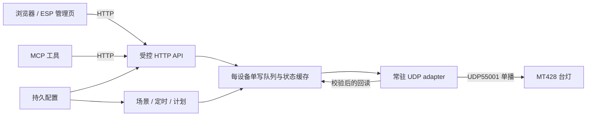

# 欧普 MT428 本地适配器架构

[English](architecture.en.md) · [研究与证据](research.zh-CN.md)

对象：**MT428-D0.5×36+0.2×21-WTT**，已测 SKU `0x50061`、版本原始字段 `0x210`。本文定义通用部署架构与后续接口契约，不代表已完成路由器常驻部署、ESP 页面集成或 MCP 验收。已测能力及来源以研究文档为准；本次只整理文档，没有连接台灯或发送报文。

示例台灯 `192.0.2.42` 是 TEST-NET-1 文档地址，`02:00:00:00:00:01` 是合成本地管理单播 MAC；部署前必须替换为获授权设备的实际配置。文中不包含用户私网拓扑、真实设备标识或账户材料。

## 1. 一个协议适配器，多个管理入口

将轻量 UDP adapter 常驻在路由器或同网常驻主机上，对外提供 HTTP 服务。ESP 管理页、普通浏览器与 MCP 调用同一服务；场景、定时和计划也进入同一执行队列。ESP 不承担台灯 UDP 的必经转发职责，ESP 下线不应阻断路由器已接管的控制或计划。



这里的“单写”指同一台灯的所有写入只有一个执行所有者，不意味着只允许一个管理页面。HTTP 并发处理、后台轮询、重试、恢复和计划不得各自建立互相竞争的控制器。官方 App 和实体按键属于服务外部的变化来源；单写队列无法阻止它们操作设备，适配器需通过回读识别状态变化。

OpenWrt 类系统可用 procd 托管，其他系统使用相应进程管理器。运行时可用轻量 Lua 或小型可执行程序，选型取决于 UDP、校验算法、锁和计时能力；不要为每次 HTTP 请求启动一个独立轮询器。具体语言、打包和启动命令由实现与 README 说明，不把某一用户路由器的资源或目录布局写成前提。

## 2. 身份、配置与迁移

外部使用固定逻辑 `deviceId`，例如 `opple_mt428_01`。它与 DHCP 地址、适配器运行主机、发现报文中的协议设备标识分离；设备换网络时，自动化仍引用同一个逻辑 ID。

| 配置／状态 | 稳定性与用途 |
| --- | --- |
| `deviceId` | 服务命名空间内的逻辑身份；迁移时保留，避免直接以 IP 命名工具或场景。 |
| 台灯 IP | 可迁移的连接配置；可由操作者设置 DHCP 地址保留，也可显式更新，不能假设旧地址永久有效。 |
| 预期 MAC | 在本地受限配置中核验设备身份，不在公开日志或 API 示例中放真实值。MAC 校验不是密码学认证。 |
| 协议设备标识、序号、接收端口 | adapter 的运行状态；重新发现后获取，不与逻辑 `deviceId` 混淆。 |
| SKU、版本原始字段 | 选择经验证的协议配置并记录能力边界；新版本或不匹配时先降为只读，不能自动扩大支持范围。 |
| HTTP 监听、Host／Origin、private-network 策略 | 独立的访问配置，不跟台灯 IP 自动推导，也不属于设备身份。 |
| 场景／计划 ID、配置修订号 | 由服务维护并持久化；管理页与 MCP 引用同一份定义。 |

以下 JSON 仅示意配置概念，**不是已经承诺的配置文件格式**：

```json
{
  "deviceId": "opple_mt428_01",
  "lampIp": "192.0.2.42",
  "expectedMac": "02:00:00:00:00:01",
  "udpPort": 55001,
  "mode": "read-only",
  "privateNetwork": { "enabled": false },
  "timeZone": "Asia/Shanghai"
}
```

迁移步骤为：保留 `deviceId` 与场景／计划 ID；按官方方式接入目标 2.4 GHz 网络；更新 IP、预期身份及 HTTP／private-network 访问配置；先只读发现与回读，再由操作者另行确认可写测试；核对时区、时间同步和计划归属后恢复计划。不能为迁移盲目恢复出厂、清除绑定或改固件。恢复出厂后的完全离线配网尚未验证。

跨网管理通过到本地 HTTP 服务的受认证访问或私网通道完成。已验证的 UDP55001 控制不依赖 `238.238.238.238:5683` 组播，不需要把该组播搬到远端网络；单播请求和回包仍必须可达。

## 3. 单写队列、事件 ID 与回读

每设备维护一个执行 worker。入口先校验身份、权限、模式、能力和参数，再将操作交给它；多字段控制、临时开灯、回读、恢复关闭作为一个不被本服务其他操作插入的队列任务。只给单个 UDP `send` 加锁不足以保护整个流程。部署应通过进程所有权／锁避免同时启动两个真实写入实例。

建议的执行顺序：

1. 分配或接收 `eventId`，检查幂等键、设备和配置修订号，将任务标为 `accepted`。
2. 获取新鲜状态并核验设备身份；缓存不足以证明当前开关状态。
3. 计算完整操作步骤和亮灯风险，按策略拒绝、直接执行或允许临时开灯；不补猜未知字段。
4. 串行发送已允许的绝对值命令，按消息类型、来源、长度、序号、CRC 过滤回复；写入后主动 QUERY。
5. 对比请求值与实际回读。数值容差应由协议配置明确给出，同时返回请求值和报告值，不能默默夹紧后宣称精确成功。
6. 若需要恢复关闭，将恢复视为必须记录结果的步骤；最后生成事件结果及最新可信状态。

`eventId` 是管理层操作标识，与 UDP 请求序号分开。HTTP 重试携带相同幂等键时返回已有事件或其状态，不新建重复执行；同一键配不同参数应拒绝。去重记录必须有容量和保留策略；需要跨重启去重的计划不能只依赖内存。使用明确的 `power=true/false`，避免 toggle 使重复请求反转状态。

| 结果 | 调用者应如何理解 |
| --- | --- |
| `accepted` / `queued` | 服务已接收，尚未证明台灯执行。 |
| `sent` / `verifying` | 已发送，正在回读；不是成功确认。 |
| `verified` | 对应字段通过有效的新鲜回读；不证明照度、物理色温或侧灯效果。 |
| `partial` / `failed` | 有步骤未达目标；需提供各字段及恢复关闭的结果。 |
| `unknown` | 丢包或回读失败导致无法判断最终效果；不得当作“未执行”或成功。 |
| `rejected` | 参数、模式、能力、身份或风险策略不允许；未为该请求发控制报文。 |

UDP 不能提供跨崩溃的“恰好执行一次”保证：命令可能生效但回复丢失。有限重试只适用于允许重复的绝对值操作，重新发现、回读和重试使用同一队列并做退避。不得用无限重试制造闪亮，也不得为兼容其他灯具而移除本型号已可用的序号校验。

状态缓存至少保留 `observedAt`、是否在线、状态来源、是否过期、最后一次错误和字段可信度。服务健康与设备在线分开表示；离线时可显示最后已知值，但必须标为过期。多个页面读取缓存，轮询合并且温和；写后回读优先，不让每个浏览器都直接触发独立高频查询。轮询间隔需后续验证，不宣称已测吞吐量。

## 4. 关灯调参、read-only、simulate 与实验侧灯

**已测固件在关灯时忽略调光。“开启 → 调参 → 恢复关闭”可能闪亮，最终关闭并不代表全过程保持黑暗。** 该行为涉及恢复、自动化及组合参数操作。新服务应默认拒绝需要临时开灯的调参，或要求调用者显式接受此步骤；这是目标策略，不能反推所有历史原型已经使用该默认值。恢复关闭失败要在事件和界面中显著返回，不能隐藏在“控制成功”下。

| 模式／门禁 | 真实设备允许的行为 |
| --- | --- |
| 默认 `read-only` | 仅定向发现、查询和状态展示；拒绝所有直接或间接写入，不启动会写灯的定时任务。 |
| 显式 `--allow-write` | 可执行已经验证的三字段控制，仍需参数、身份、亮灯风险及回读校验。 |
| 仅 `--experimental-side-light` | 可展示试验性 `side_light` 解析；没有真实侧灯写入权限。 |
| 两项标志同时启用 | 满足实验侧灯写入的配置门槛；仍不等于实机支持或当前研究阶段的写入授权。 |
| `simulate` | 使用模拟 transport；即使进行虚拟写入，也不得创建真实设备发包路径，不发现真实设备、不发组播、不访问云端。 |

read-only 必须在 HTTP 业务层和最底层真实 transport 双重执行。场景、恢复、后台计划和 MCP 不能绕过它；只读启动时已有持久计划应暂停，不能悄悄排队等待未来变为可写。simulate 响应及事件都要标为模拟，避免把合成回读记为实测。

实验侧灯依据官方分发 APK 的静态事实：`0x50061 → WifiDesklamp_0061`、`ArmControl`、`SEND_ARM_OPENCLOSE`／`SEND_ARM_BRIGHT`，以及 UDP55001 上的 `SEND_SMARTFUNCTION = 0x03450000`。10 字节控制 body 中 arm 开关／亮度位于 `4 / 5`，head 开关／亮度位于 `6 / 7`，head 色温位于 `[8:10]`；候选 QUERY 字段位于 `52 / 53 / 54 / 55 / [56:58]`。这些均为 A 级证据，来源元数据和散列见研究文档。

解析结果单独带 `experimental`、`apk_static` 和“未实机验证”标记，不覆盖可靠的 `power@1`、`brightness@2`、`cct@[7:9]`。官方模板中的未改开关 `2`、未改亮度 `0`、未改色温 `0` 是否在当前固件保持其他字段，仍未知；实验命令也可能联动主灯。**当前阶段、包括今晚，不发送这些未知写命令，也不盲枚举其他命令。** 白天在有人看护时完成官方 App／物理按键差分并取得后续明确授权后，才考虑最小真实写入验证。

## 5. HTTP 契约与 ESP／MCP 入口

下表是接口概念，不是当前版本全部已经实现的路由清单。实际路径和参数应由 README／实现给出。多设备扩展应显式携带 `deviceId`；客户端不能提供任意目标 IP、端口、原始命令号或报文字节。

| 接口概念 | 职责 |
| --- | --- |
| `status` / `capabilities` | 返回在线状态、观测时间、过期标记、三字段可信状态、运行模式及能力证据。试验性字段单列。 |
| `control` | 只接收已知字段的绝对值；校验范围、临时开灯策略和权限，返回 `eventId` 与执行／回读结果。 |
| `scene` | 按服务保存的 `sceneId` 执行三字段组合；明确为本地预设，不写原厂最爱或伪装电脑模式。 |
| `timer` / `cancel_timer` | 明示执行方、截止时间、是否持久化及取消状态，不承诺灯内执行。 |
| `events` | 查询操作进度、各字段结果及恢复结果；事件中不含原始报文或真实网络标识。 |
| 配置／计划管理 | 独立管理权限、校验及配置修订；不能通过普通控制接口任意改目标设备。 |

ESP 管理页增加独立台灯区域，展示实际回读、离线／过期、只读及实验能力。它可与路由器 HTTP 服务采用同源部署或受控代理；若页面由其他主机提供，按明确的访问策略接入。不同灯组、其他设备屏幕亮度和台灯要分别命名，避免旧页面“全灯”意外包含新增设备。按钮、滑块、场景及恢复前均展示适用的临时亮灯警告；滑块提交需要合并，不能按每个移动像素发设备命令。

MCP 工具可使用 `get_lamp_status`、`set_lamp_power`、`set_lamp_brightness`、`set_lamp_color_temperature`、`apply_lamp_scene`、`set_lamp_timer`／`cancel_lamp_timer` 和 `get_lamp_capabilities`。这些是拟议工具名，不假定现存 MCP 框架或传输。MCP 只翻译已允许的参数并调用 HTTP，不自行发送 UDP、猜测命令或绕过亮灯确认；能力未知时不能凭工具调用成功声称侧灯或原厂功能已支持。

## 6. 配置持久化、闪存和时间计划

将静态连接配置、场景及计划与运行缓存分开。配置只在明确变更时做完整校验、带修订号的原子替换和必要的同步；保留可恢复的上一版。运行状态、序号、频繁轮询结果和短日志放内存或易失存储，不因每次回读刷写闪存。事件日志设大小与保留上限，不记录抓包或设备真实标识。确需持久事件去重时，使用有界日志和合并写入，在恢复能力与闪存寿命间明确取舍。

| 定时类型 | 执行／持久性边界 |
| --- | --- |
| 已测进程内关灯定时 | 服务存活时执行；进程退出／重启即丢失。使用单调时钟计算运行中的相对时长。 |
| 拟议路由器计划 | 由唯一服务执行，不依赖浏览器或 ESP 在线；需新增持久化、重启恢复和校时测试，尚未验收。 |
| 原厂计划、倒计时、番茄钟 | 官方描述存在，但本地配置／执行接口尚未适配；不与前两者合并宣传。 |

持久计划至少包含 `scheduleId`、`deviceId`、动作／`sceneId`、启用状态、IANA 时区、重复规则和配置修订。记录具体执行实例的事件 ID，例如由“计划 ID + 修订号 + 计划触发的 UTC 时刻”生成，配合最后执行结果防止重启、时钟回拨或重读配置重复触发。

运行中的相对倒计时用单调时钟；需要跨重启恢复时，另存绝对截止时刻和恢复策略，不能持久化一个没有跨进程意义的单调时钟值。时间计划等待系统时钟可信后再启用，明确夏令时重复／缺失时段与校时跳变策略。默认不补执行过期的开灯任务；错过事件应记录为跳过，跨重启倒计时的补执行也必须有显式策略。取消和修改计划应与队列协调，避免已取消任务仍以旧修订发包。

本服务内部避免重复执行，并不代表可阻止原厂计划或 App 改灯。启动服务不应自动清除原厂计划；遇到冲突要报告来源未知，交由操作者核对，不发送尚未知的“清空计划”命令。

## 7. private-network 与访问控制

private-network 指允许私网客户端访问 HTTP 的部署策略，不是“私网天然可信”的承诺，也不是组播转发功能。默认仅允许本机或同源受控代理；显式启用私网访问时，分别配置监听接口、访问身份、Host／Origin 白名单、允许的来源及请求限制。文档中的 TEST-NET 地址不能当成实际私网验证或自动放行依据。

浏览器到私网服务可能受到混合内容、跨域、Private Network Access／本地网络权限策略影响，行为依浏览器和版本而异；优先采用同源入口或受控代理，不为绕过浏览器限制而关闭访问检查。Host／Origin 校验能缩小攻击面，但不能替代身份认证，特别是 MCP 等非浏览器客户端。

HTTP 应限制请求体、速率与字段，明确读取和控制权限，保护跨站写入入口；不要开放任意 CORS 或把未经认证的 HTTP、台灯 UDP 直接映射公网。CRC／MAC XOR 不提供安全认证，公开 API 也不需要暴露真实 MAC、协议标识或完整 body。原厂云通信与本地控制是不同路径，是否限制云联网需另行对照实测，不能作为此架构成立的先决条件。

## 8. 交付与后续验收

| 阶段 | 可复核的验收重点 |
| --- | --- |
| 文档与模拟 | 两种语言的事实、命令、偏移和限制一致；simulate 不发送真实流量。使用合成数据检查 CRC、类型／长度／序号错误、只读拒绝、掉线、关灯恢复失败、实验门禁和事件去重。 |
| 默认只读 | 仅向明确配置设备发现／查询；身份不符就停止。验证三字段回读与实验候选字段的来源区分，不写灯。 |
| 已验证能力的白天复测 | 后续另行授权后，对开关、亮度、色温、本地场景与进程内定时做小范围回归，观察临时亮灯及恢复结果。 |
| 实验侧灯 | 先完成研究文档中的 App／按键差分；核对模板占位和主灯副作用。没有真机证据时持续显示“实验、未验证”，不因静态解析或模拟通过升级支持状态。 |
| 常驻路由器 | 新增服务重启、掉线重连、单写所有权、闪存写入、时钟跳变与计划去重验收；当前不是完成状态。 |
| ESP 页面／MCP／迁移 | 共同使用 HTTP 契约，ESP 离线不影响服务计划，原有设备功能不被误控制；迁移只改连接及访问配置，逻辑 ID 不变。 |

本次不执行上述设备或部署验收。本文与研究文档相互链接，安装和运行入口由 README 承担。参考且链接，许可见 [THIRD_PARTY_NOTICES.md](../THIRD_PARTY_NOTICES.md)；不在本文推定第三方许可或分发 APK、SDK、反编译代码、图片及原始报文。
